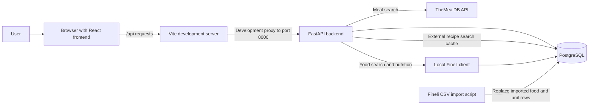
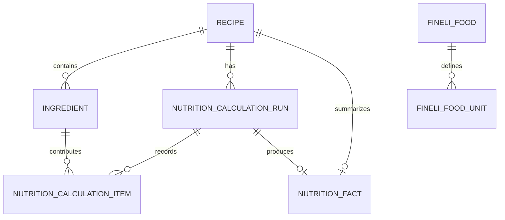
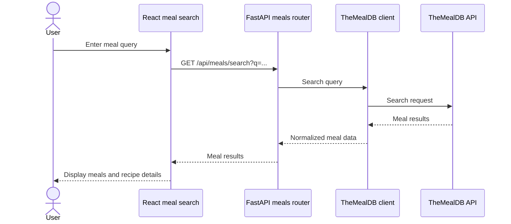
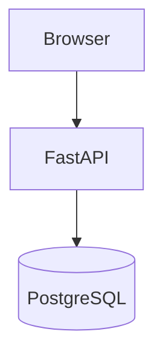

# Project Architecture

## Overview

Recipe App is a browser-based recipe application. Its current runtime consists of a
React and TypeScript frontend, a Python and FastAPI backend, and PostgreSQL. The
backend also integrates with TheMealDB for external meal data. Fineli food and
nutrient data is imported from a local dataset and read from PostgreSQL; lookups do
not call Fineli's online API.

## System context

In local development, Vite runs on port `5173` and proxies `/api` requests to FastAPI
on port `8000`. The repository does not define production deployment routing.

## Components

| Component | Responsibility |
| --- | --- |
| React frontend (`frontend/src`) | Provides meal search, saved-recipe list and detail pages, and recipe creation. |
| Vite (`frontend`) | Serves the frontend during development and proxies `/api` requests to FastAPI. |
| FastAPI (`backend/app/main.py`) | Registers API routers, configures CORS, creates missing tables at startup, and exposes the health endpoint. |
| Recipe and ingredient routers | Create, list, retrieve, and delete saved recipes; update an ingredient's Fineli match. |
| Meal and external-recipe routers | Fetch and normalize TheMealDB results. External-recipe search responses are cached in PostgreSQL. |
| Ingredient and nutrition routers | Search the imported Fineli dataset and calculate recipe nutrition using matched foods and gram/kilogram quantities. |
| Local Fineli client | Reads food names and nutrient values from PostgreSQL; it does not make network requests. |
| Fineli import scripts | Stage the release 20.0 CSV files and replace the imported Fineli food and household-unit rows. |
| PostgreSQL | Persists recipes, ingredients, nutrition calculation history and facts, external-recipe cache entries, and imported Fineli data. |
| TheMealDB | Supplies external recipe search and details through the backend integration. |

## Main data model

Recipe ingredients can optionally reference a Fineli food. A nutrition calculation
requires every ingredient to have a Fineli match and a quantity in `g` or `kg`.
Calculation runs and their items preserve the inputs used for a calculation, while
the recipe's nutrition fact points to the current result. The imported Fineli unit
conversion rows are stored, but household-unit conversion is not yet used by the
nutrition calculation endpoint.

## Key request flows

### Search external meals

The current home page calls `GET /api/meals/search?q=...`. FastAPI calls TheMealDB,
maps its response to the frontend's meal shape, and returns it to the browser. The
separate `/api/external-recipes` router offers additional search, filter, and detail
routes; its search route caches responses in PostgreSQL. The current home page does
not use that router.

### Import Fineli data

The Fineli archive is downloaded manually. The staging script extracts the seven
required CSV files, and the importer maps foods, nutrient values, and household-unit
rows into PostgreSQL. Re-running the importer replaces the previous imported Fineli
rows. The archive and staged data are not committed to git.

### Calculate recipe nutrition

The backend loads each matched food from the local Fineli tables, scales its
per-100-gram nutrient values by the ingredient quantity, stores a calculation run
and its items, and returns the recipe totals. Missing matches, unsupported units, or
required nutrient values result in a validation error rather than a guessed total.

## Current frontend coverage

- The home page searches TheMealDB through `/api/meals/search`.
- Saved-recipe pages use the recipe API to list, create, retrieve, and delete recipes.
- Fineli food search and recipe nutrition endpoints exist in the backend, but the
  current frontend does not yet expose Fineli matching or nutrition results.

## Mermaid in GitHub Markdown

GitHub renders supported Mermaid diagrams from a fenced Markdown code block whose
language identifier is `mermaid`. Keep the diagram definition inside the fence, use
plain labels and standard diagram syntax, and avoid embedding HTML or relying on
custom renderer settings.

See [GitHub's diagram documentation](https://docs.github.com/en/get-started/writing-on-github/working-with-advanced-formatting/creating-diagrams)
and the [Mermaid documentation](https://mermaid.js.org/intro/) for supported syntax
and diagram types.

## Related documentation

- [API usage guide](./API_USAGE.md)
- [Fineli data guide](./FINELI_DATA_GUIDE.md)

`API_USAGE.md` also describes a proposed TypeScript client/server organization.
That layout is not the current runtime architecture documented here.
